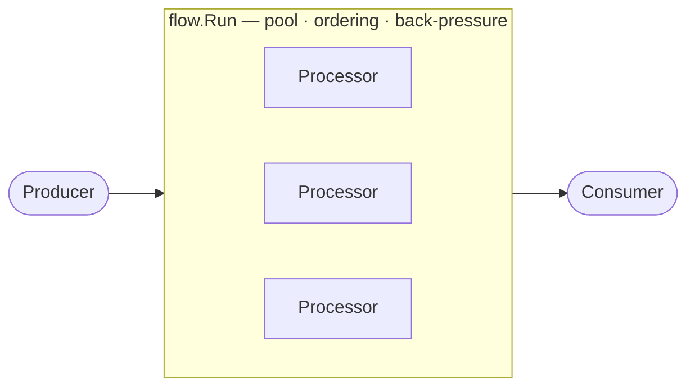

# flow

[](https://github.com/pabloos/flow/actions/workflows/ci.yml)
[](https://github.com/pabloos/flow/actions/workflows/ci.yml)
[](https://pkg.go.dev/github.com/pabloos/flow)


**Implement the ends, flow owns the pipes.** You write a `Producer`, a
`Processor` and a `Consumer` (or just pass closures); flow provides the
concurrency, ordering, back-pressure and fail-fast cancellation. Zero
dependencies.

```go
double := flow.Map(func(n int) int { return n * 2 })

var out []int
err := flow.Run(ctx, flow.Slice(1, 2, 3, 4), double, flow.Into(&out),
    flow.Workers(4), flow.Ordered())
// out == [2 4 6 8] — parallel, deterministic
```

No channels, no `WaitGroup`, no fan-in wiring in your code — just single-item
logic and a couple of options.

## The idea

A pipeline is always the same shape: a producer at one end, a consumer at the
other, work in the middle.



flow inverts control: instead of chaining channel operators yourself, you
implement three small interfaces and hand them to `Run`, which owns the
infrastructure. The design is inspired by Elixir's
[GenStage](https://github.com/elixir-lang/gen_stage), adapted to idiomatic Go.

## Install

```sh
go get github.com/pabloos/flow
```

Requires Go 1.23+.

## The three interfaces

```go
type Producer[T any]     interface { Produce(ctx context.Context, emit func(T) error) error }
type Processor[I, O any] interface { Process(ctx context.Context, in I, emit func(O) error) error }
type Consumer[T any]     interface { Consume(ctx context.Context, v T) error }
```

Implement them on a struct for stateful/complex ends, or pass a closure via the
`*Func` adapters (the `http.HandlerFunc` trick) for quick ones:

```go
// A struct end carries state; the consumer runs single-threaded, so no locks.
type Sum struct{ total int }

func (s *Sum) Consume(ctx context.Context, n int) error {
    s.total += n
    return nil
}
```

**One `Processor` is Map, Filter and FlatMap** — it depends on how many times
you `emit`:

```go
flow.ProcessorFunc[int, int](func(ctx context.Context, n int, emit func(int) error) error {
    if n < 0 { return nil }          // Filter: emit nothing
    if err := emit(n); err != nil {  // Map: emit one
        return err
    }
    return emit(n * 10)              // FlatMap: emit more
})
```

For the common cases, terse constructors hide the `emit` closure (with fallible
`Try*` variants):

```go
flow.Map(func(n int) int { return n * 2 })
flow.Filter(func(n int) bool { return n > 0 })
flow.FlatMap(func(s string) []string { return strings.Fields(s) })

flow.TryMap(func(s string) (int, error) { return strconv.Atoi(s) })
```

## Composition

`Then` composes processors **with no channel between them** — plain function
composition, so multi-stage pipelines run in-process inside each worker:

```go
parse := flow.TryMap(strconv.Atoi)                    // string -> int
scale := flow.Map(func(n int) float64 { return float64(n) * 1.5 })
proc  := flow.Then(parse, scale)                      // Processor[string, float64]
```

## A complete program

Parse strings to ints, keep the positives and double them — in parallel, with
the output order preserved:

```go
package main

import (
	"context"
	"fmt"
	"strconv"

	"github.com/pabloos/flow"
)

func main() {
	pipeline := flow.Then(
		flow.TryMap(strconv.Atoi),
		flow.Then(
			flow.Filter(func(n int) bool { return n > 0 }),
			flow.Map(func(n int) int { return n * 2 }),
		),
	)

	var out []int
	err := flow.Run(context.Background(),
		flow.Slice("1", "-2", "3", "4"),
		pipeline,
		flow.Into(&out),
		flow.Workers(4), flow.Ordered(),
	)
	if err != nil {
		panic(err)
	}
	fmt.Println(out) // [2 6 8]
}
```

More runnable examples live in the [package docs](https://pkg.go.dev/github.com/pabloos/flow#pkg-examples)
(they run in CI, so they never go stale).

## Concurrency and ordering

Both are options on `Run` — your processor code stays single-item and oblivious:

```go
err := flow.Run(ctx, producer, proc, consumer,
    flow.Workers(8),    // pool size (parallelism)
    flow.Ordered(),     // reconstruct input order at the consumer
    flow.Prefetch(64),  // in-flight window: let the producer run ahead
)
```

`Prefetch(n)` is `n` items queued ahead of the pool. `Run` queues them in one
shared channel, so the window is `n`; `RunPartitioned` gives each worker its own
queue — that is what stops one slow key from stalling the others — so the window
is `n` per worker, `n × Workers` in total.

`Ordered()` restores the original input order even though workers finish at
different times (and it survives `FlatMap` sibling expansion). Without it,
outputs are consumed as they arrive. The consumer is always called from a single
goroutine, so it needs no locks.

### Keyed ordering

`RunPartitioned` routes every input to a worker by key, so all values with the
same key go to the same worker and are processed in order — a given key is never
processed concurrently. Use it for per-key ordering or processors that keep
per-key state:

```go
err := flow.RunPartitioned(ctx, producer, proc, consumer,
    func(e Event) string { return e.UserID }, // same user -> same worker, in order
    flow.Workers(8),
)
```

Combine it with `Ordered()` to also restore the global input order at the
consumer; on its own it only guarantees order within each key.

Strings and the integer types are hashed directly and allocation-free. Return a
`uint64` and it is taken as the hash itself, which is how you pick the
distribution yourself:

```go
func(e Event) uint64 { return myHash(e.Tenant) }
```

Any other comparable key falls back to hashing its `%#v` form — correct, but
slower; prefer a fast path on a hot pipeline.

## Batteries-included ends

```go
flow.Slice(1, 2, 3)          // Producer from values
flow.FromSeq(seq)            // Producer from a Go 1.23 iter.Seq

flow.Into(&results)          // Consumer that collects into a slice
flow.Each(func(v T) error)   // Consumer that runs a func
```

## Errors and cancellation

The first error from any end — producer, processor or consumer — cancels the
whole pipeline (fail-fast) and is returned by `Run`:

```go
err := flow.Run(ctx, prod, flow.TryMap(risky), sink)
if err != nil { /* the pipeline stopped at the first failure */ }
```

The error is wrapped in a `*StageError` naming the end it came from, so you can
tell whose fault it was without instrumenting your own ends. The original error
stays reachable through `errors.Is` / `errors.Unwrap`:

```go
var se *flow.StageError
if errors.As(err, &se) && se.Stage == flow.StageConsumer {
    // the sink failed, not the work
}
```

A run stopped by its caller's context returns that context error unwrapped —
no stage failed, so there is nothing to name.

Back-pressure is implicit: `emit` blocks while the pipeline is saturated, all the
way back to the producer.

## Profiling & bottlenecks

Because flow owns the infrastructure, it can profile it for you — with no
instrumentation in your code. Pass `Observe` to fill a `Report` that pinpoints
the bottleneck:

```go
var rep flow.Report
err := flow.Run(ctx, prod, proc, cons, flow.Workers(8), flow.Observe(&rep))
fmt.Println(rep)
```

```
flow report — wall 104ms · 8 workers
  producer   3000 items   blocked 101ms
  processor  3000 in / 3000 out   busy 810ms  idle 1ms  blocked 4ms  · 98% util
             latency  p50 120µs  p95 3.004ms  p99 3.025ms  max 3.14ms
             balance  busy 101ms–103ms across 8 workers
  consumer   3000 items   busy 0s
  → bottleneck: PROCESSOR
    processor-bound: raise Workers() or optimize Process
```

flow triangulates by where the workers spend their time — **idle** (producer too
slow), **busy** (the work itself) or **blocked** (consumer too slow) — so
`rep.Bottleneck` is one of `StageProducer` / `StageProcessor` / `StageConsumer`,
with matching `Advice`. The **latency** line exposes the Process tail (here p50
is 120µs but p95 jumps to 3ms — a spike a mean would hide), and **balance**
flags uneven workers; the full data is in `rep.ProcessLatency` and
`rep.PerWorker`. `Observe` is opt-in; with it off, the hot path pays nothing.

### Streaming metrics

`Observe` is a one-shot snapshot; for live metrics during a run — and for
long-lived pipelines that never "end" — implement `Meter` and pass `Metrics`.
flow records the counters `produced` / `processed` / `emitted` / `consumed` and
the histograms `process_latency`, `worker_idle` and `worker_blocked` to your
instruments — the same busy / idle / blocked split `Observe` uses to localize
the bottleneck, but live and per-interval:

```go
err := flow.Run(ctx, prod, proc, cons, flow.Workers(8), flow.Metrics(m))
```

`Meter` is deliberately tiny (instrument-based, à la OpenTelemetry) so the core
stays zero-dependency; concrete exporters live in separate submodules under
`flow/x/…`, so only code that needs one pulls in its dependencies.

Instruments are created with optional `Attr` key/value pairs. flow's attributes
are static per instrument — a worker index, a stage name — never per
measurement, so an exporter bakes them in once (Prometheus const labels, a
precomputed OpenTelemetry attribute set) and `Add` / `Record` stay
allocation-free. Attributes are part of an instrument's identity: same name,
different attrs means a different series.

**Implementing `Counter` and `Histogram` is enough, and will stay enough.** flow
will not add a method to `Meter`, `Counter` or `Histogram`; new kinds of
instrument arrive as separate optional interfaces that the engine discovers with
a type assertion — the `http.Flusher` pattern — so a `Meter` written today keeps
compiling and keeps working.

The Prometheus exporter is the first:

```sh
go get github.com/pabloos/flow/x/prometheus
```

```go
import (
    flowprom "github.com/pabloos/flow/x/prometheus"
    "github.com/prometheus/client_golang/prometheus"
)

reg := prometheus.NewRegistry()
err := flow.Run(ctx, prod, proc, cons,
    flow.Workers(8),
    flow.Metrics(flowprom.NewMeter(reg)),
)
// reg now exposes flow_produced_total, flow_processed_total, flow_emitted_total,
// flow_consumed_total and the flow_process_latency_seconds / flow_worker_idle_seconds
// / flow_worker_blocked_seconds histograms
```

The OpenTelemetry exporter feeds the same measurements to any OTel pipeline
(OTLP, the Prometheus bridge, stdout):

```sh
go get github.com/pabloos/flow/x/otel
```

```go
import (
    flowotel "github.com/pabloos/flow/x/otel"
    "go.opentelemetry.io/otel"
)

err := flow.Run(ctx, prod, proc, cons,
    flow.Workers(8),
    flow.Metrics(flowotel.NewMeter(otel.Meter("flow"))),
)
// records the counters flow.produced, flow.processed, flow.emitted,
// flow.consumed and the flow.process_latency / flow.worker_idle /
// flow.worker_blocked histograms (seconds)
```

## Prior art

- [destel/rill](https://github.com/destel/rill) — composable channel operators with ordered variants; a great fit if you like the operator-chaining style.
- [reugn/go-streams](https://github.com/reugn/go-streams) — Source/Flow/Sink DSL with many connectors (Kafka, NATS, …).
- [Elixir GenStage](https://github.com/elixir-lang/gen_stage) — the demand-driven inspiration for the "implement the ends" model.

flow's niche is the interface-driven ergonomics: you plug in the ends, it owns
the pipes.

## History

flow began as the generics rewrite of [GoPipelines](https://github.com/pabloos/GoPipelines),
a pre-generics study of the [Go pipelines pattern](https://blog.golang.org/pipelines).
Its lineage is preserved in the repo:

- `v1-legacy` tag — the original `int`-only pattern.
- `channel-api` tag — the generics rewrite with an explicit channel/`Stage` API.
- `main` — the current interface-driven design.

## Roadmap

Observability grows without breaking the core's zero-dependency promise:

- **In core** (stdlib only): `Report` percentiles and per-worker breakdown
  (done, v0.4.0) and the `Meter` streaming hook (done, v0.5.0).
- **Separate modules** (own `go.mod`, opt-in): concrete exporters implementing
  `Meter` under `flow/x/…` — Prometheus (`x/prometheus`) and OpenTelemetry
  (`x/otel`), both done — so importing the core never pulls their dependencies.

## Limitations

- Back-pressure is by blocking `emit`, not demand-driven like GenStage.
- Multi-stage type changes compose two at a time (`Then`), a Go generics
  constraint — turned into in-process, channel-free composition.

## License

MIT
